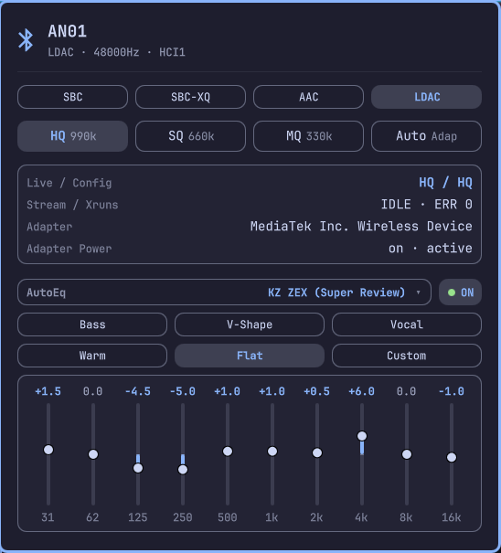

# BT & Audio EQ

Omarchy Quattro bar widget for controlling Bluetooth A2DP codecs, codec quality, PipeWire sample rates, live audio telemetry, and a 2-stage PipeWire Equalizer with AutoEq support.



## Features

- **A2DP Codec Switcher**: Lists available `a2dp-sink*` profiles from `pactl list cards` (`LDAC`, `AAC`, `SBC-XQ`, `SBC`, etc.) and switches profiles live.
- **Adaptive Quality Control**:
  - **LDAC**: `HQ` (990k), `SQ` (660k), `MQ` (330k), `Auto` (ABR) via `bluez5.a2dp.ldac.quality`.
  - **AAC**: `CBR` (`0`), `VBR 1`, `VBR 3`, `VBR 5` via `bluez5.a2dp.aac.bitratemode`.
  - **Fixed-bitrate profiles & System PCM**: Displays the active profile/output state.
- **Dynamic Sample Rate Selector**: Reads supported `EnumFormat` rates from `pw-dump` and switches `clock.allowed-rates` / `clock.force-rate` live via `pw-metadata`.
- **2-Stage PipeWire EQ + AutoEq**:
  - Stage 1: Parametric EQ (`PK` / `LSC` / `HSC` biquads) from the AutoEq database, automatically paused when Bluetooth disconnects and resumed on reconnect.
  - Stage 2: 10-band ISO graphic EQ (`31 Hz` – `16 kHz`, `±15 dB`) layered on top of Stage 1 with `Bass`, `V-Shape`, `Vocal`, `Warm`, `Flat`, and `Custom` presets.
- **Event-Driven Updates**: Uses `pactl subscribe` for instant connect/disconnect/profile updates with zero background Python polling when the panel is closed.

## Sample Rate Behavior & Limitations

- **Bluetooth A2DP (`LDAC` / `AAC` / `SBC`)**: The active A2DP sample rate (e.g., `96 kHz` vs `48 kHz` on LDAC) is negotiated and locked by BlueZ and the headphones at connection time (`EnumFormat`). Changing `clock.force-rate` at runtime via `pw-metadata` cannot renegotiate an already-established Bluetooth transport. If a device falls back to `48 kHz` (for example, after switching between Bluetooth adapters or switching codecs such as `AAC`/`SBC` → `LDAC`), power-cycling the headphones is required to renegotiate `96 kHz`.
- **System PCM (`ALSA`)**: When an ALSA output sink is `SUSPENDED` or `IDLE`, PipeWire defers hardware sample-rate reconfiguration until an audio stream starts playing.

## Installation

```bash
omarchy plugin add https://github.com/simonezpx3/omarchy-bt-audio-eq.git --enable
```

## Requirements

- Omarchy 4 (Quattro / Quickshell)
- `pipewire`, `wireplumber` (0.5+), `pipewire-pulse` (`pactl`), `pw-dump`, `pw-top`, `pw-metadata`, `pw-cli`
- `python3` (standard library only)
- `systemd --user` (for applying WirePlumber/PipeWire config changes)

## Files & Network Behavior

- **WirePlumber config**: Writes `bluez5.a2dp.ldac.quality` and `bluez5.a2dp.aac.bitratemode` to `~/.config/wireplumber/wireplumber.conf.d/50-bluez-ldac.conf` and restarts `wireplumber` on quality change.
- **PipeWire EQ config**: Writes the `Equalizer` `filter-chain` (`effect_input.bt_eq`) to `~/.config/pipewire/pipewire.conf.d/60-bt-eq.conf` and restarts `pipewire` only when the AutoEq filter slot layout changes.
- **State & Cache**: Stores EQ state and 7-day AutoEq index cache in `~/.local/state/simonez-btquality/`.
- **Network**: AutoEq search and profile download fetch over HTTPS strictly from `raw.githubusercontent.com` (`jaakkopasanen/AutoEq`) with response size limits (`2 MB` index, `128 KB` profile).

## Acknowledgments

This plugin builds on the work of the following projects and maintainers:

- **[Omarchy](https://omarchy.org/)** (DHH & contributors) — Arch Linux + Hyprland desktop and the Omarchy Quattro plugin system.
- **[Quickshell](https://quickshell.outfoxxed.me/)** (outfoxxed & contributors) — Qt Quick / Wayland shell powering the bar widget and panel UI.
- **[PipeWire](https://pipewire.org/) & [WirePlumber](https://pipewire.pages.freedesktop.org/wireplumber/)** — `filter-chain` Equalizer (`bq_peaking` / `bq_lowshelf` / `bq_highshelf`), `pw-dump`, `pw-top`, `pw-metadata`, `pw-cli`, `pipewire-pulse` (`pactl`), and BlueZ5 A2DP LDAC/AAC bitrate controls.
- **[AutoEq](https://github.com/jaakkopasanen/AutoEq)** (Jaakko Pasanen & contributors) — Open-source headphone measurement and parametric/graphic EQ profile database.
- **[BlueZ](https://www.bluez.org/)** — Official Linux Bluetooth protocol stack.

## License

MIT — see [LICENSE](LICENSE).
